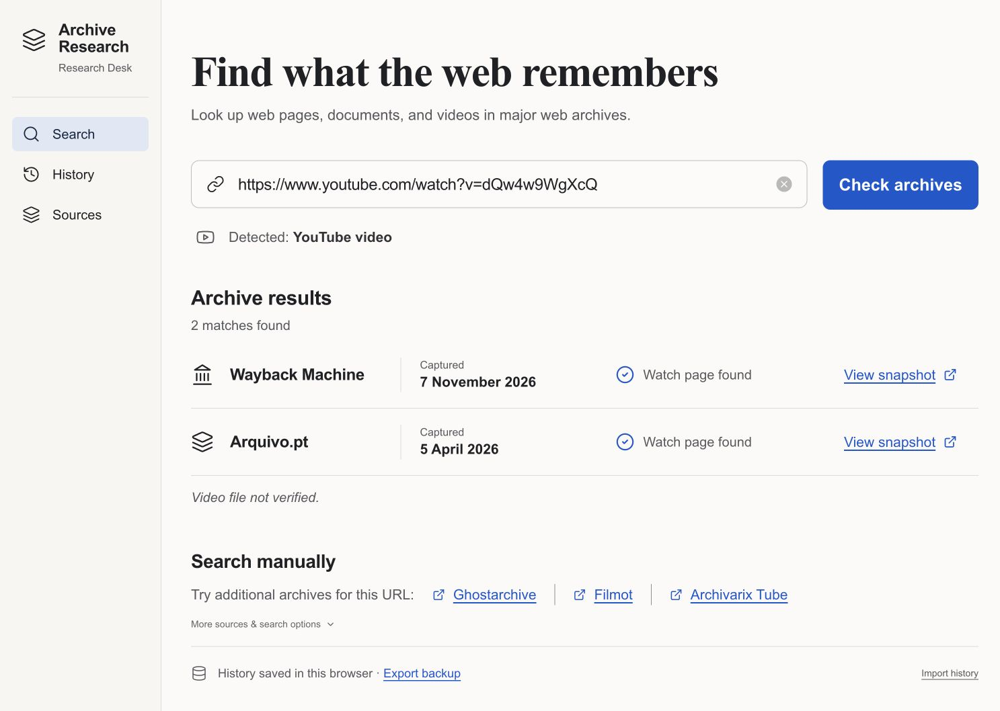

# Archive Research

A research desk for finding archived web pages and YouTube watch-page records, reviewing sources, and keeping a portable local research history.

Live app: https://archive-research.vercel.app



## Run locally

Use Node.js 22 and npm:

```sh
npm ci
npm run dev
```

Vite serves the app at http://localhost:3000/. To validate changes:

```sh
npm test
npm run typecheck
npm run build
```

## What it does

- Normalises website and YouTube URLs, including video IDs, short links, Shorts, live, and embed URLs.
- Automatically checks Wayback availability and Arquivo.pt URL history, with bounded YouTube URL variants, timeouts, and a five-minute in-session response cache.
- Distinguishes archived watch-page records from verified video files. Video playback is not verified.
- Offers manual searches across 41 archive/research tools, including Ghostarchive, Filmot, Archivarix Tube, and Quite a Playlist.
- Saves review marks per target and keeps browser-local history; provides JSON backup/import and Markdown, text, and JSON reports.
- Preserves earlier global checklist data separately because its original targets are unknown.

History is stored in the browser, not a cloud database. To move from localhost to the hosted app, export a backup from History and import it on the hosted site. Neither the app nor Vercel automatically synchronises history between devices.

The service catalogue is a directory of leads, not 41 verified automatic integrations. Availability and access vary by provider.

## Deployment

The Vercel project is `surviving-sogice/archive-research`; the repository is `sergioroxo/Archive_Research`. See [deployment notes](DEPLOYMENT.md), [design QA](design-qa.md), and the [improvement roadmap](IMPROVEMENT_PLAN.md).

No API secrets are required by the current browser-based lookups. Environment files and local Vercel linkage are excluded from Git.
